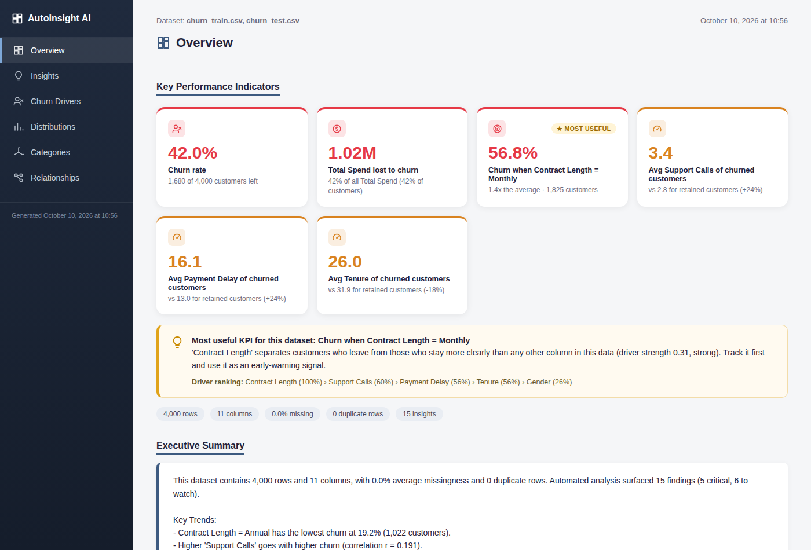
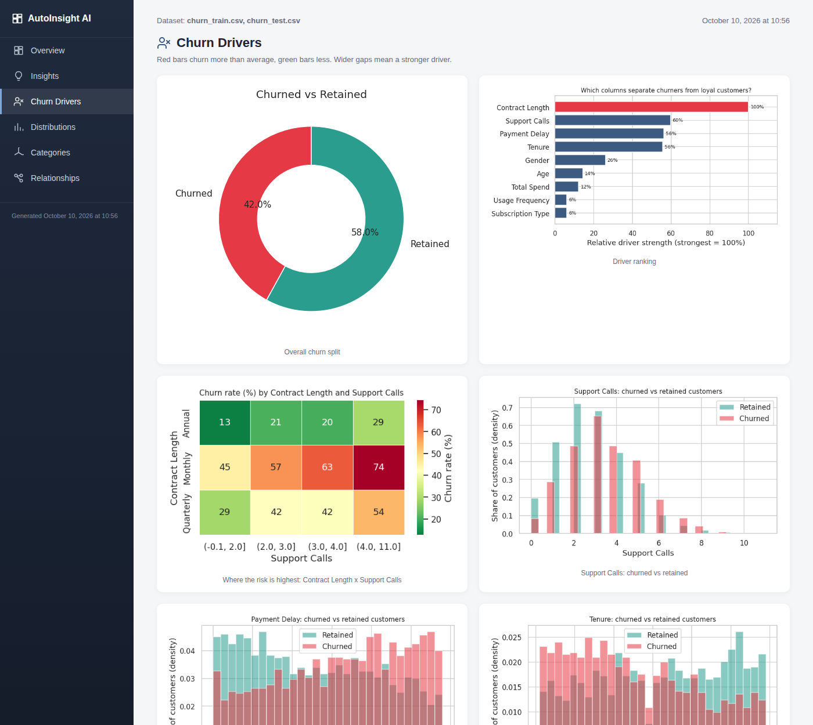
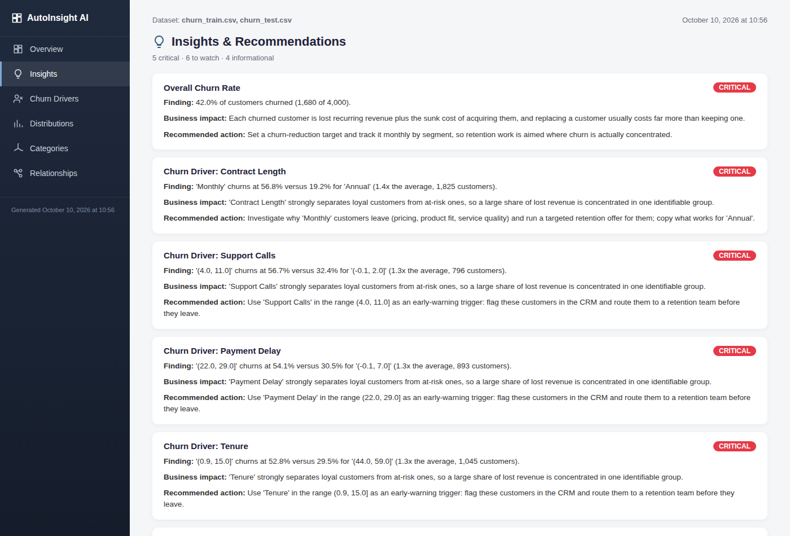
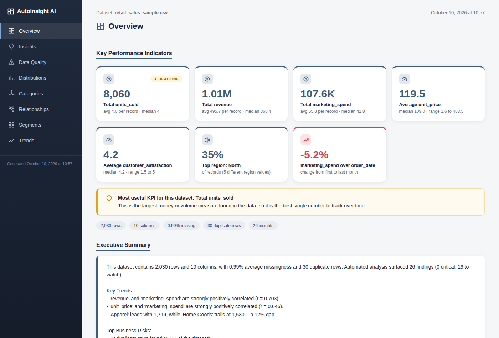
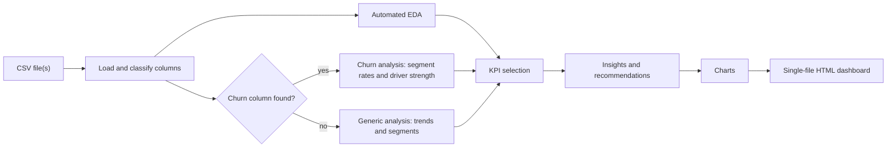

# AutoInsight AI

# [](https://github.com/YOUR_USERNAME/autoinsight-ai/actions/workflows/ci.yml)
# 
# 

**Point it at any CSV and get an analyst-style dashboard: KPIs chosen for *that* dataset, charts that suit each column type, business insights with recommended actions, and a built-in churn analysis mode.**



## What it does

- **Works on any CSV, with no setup.** Column roles (numeric, category, date, ID or free text) are detected automatically.
- **Dataset-specific KPIs.** A churn file gets churn rate, value lost to churn and the strongest churn drivers; a sales file gets totals, averages, the top category and the strongest trend. The tool also flags which KPI is the **most useful** for that dataset and explains why.
- **Charts that fit the data.** Category bars, value-band columns for numeric ranges, churned-vs-retained distributions, a risk heatmap and a driver-ranking chart.
- **Insights with next steps.** Every finding comes with a plain-English business problem and a recommended action.
- **Churn mode (automatic).** Finds the churn column, then reports churn rate by segment, which columns separate leavers from loyal customers, and the highest-risk groups.
- **One navigable HTML file.** Sidebar navigation with a page per topic. Open it by double-click; no server and no internet needed.
- **Optional Claude-written summary.** Add `--use-ai` for an executive summary written by the Claude API. All numbers are still computed by plain pandas; the model only writes the prose.

## Demo

Live demos (after you enable GitHub Pages, see [docs/index.html](docs/index.html)):
`https://YOUR_USERNAME.github.io/autoinsight-ai/`

| Churn drivers page | Insights page |
|---|---|
|  |  |

A non-churn dataset gets a different set of KPIs automatically:



## Quick start

```bash
git clone https://github.com/YOUR_USERNAME/autoinsight-ai.git
cd autoinsight-ai

python -m venv .venv
# Windows:        .venv\Scripts\activate
# macOS / Linux:  source .venv/bin/activate

pip install -e .

# Try it on the bundled sample data (two files with the same columns are combined)
autoinsight sample_data/churn_train.csv sample_data/churn_test.csv --open
```

Run it on your own data:

```bash
autoinsight path/to/your_data.csv -o output/my_report.html --open
```

No install? `python main.py your_data.csv` works too, after `pip install -r requirements.txt`.

### Command-line options

| Option | Meaning |
|---|---|
| `csv_paths` | One or more CSV files. Several files must share the same columns; they are stacked. |
| `-o, --output` | Where to save the dashboard (default `output/report.html`). |
| `--target COLUMN` | Name the churn column. Auto-detected if omitted; `--target none` turns churn mode off. |
| `--use-ai` | Executive summary written by Claude (needs `ANTHROPIC_API_KEY`, see below). |
| `--open` | Open the finished dashboard in your browser. |

## How KPIs are chosen

KPI cards are built from the dataset's own columns (`autoinsight/kpis.py`), not from a template.

- **Churn data:** churn rate; value lost to churn if a money column (balance, spend, revenue, charges...) exists; plus one KPI for each of the four columns that best separate churners from loyal customers. Categories show the riskiest group (for example "Churn when Contract = Monthly"); continuous columns show the average for churned vs retained customers.
- **Other data:** totals for money and volume columns, averages for price- and score-like columns (adding prices up would be meaningless), the dominant category, and the strongest trend over time.
- **Most useful KPI:** the column with the highest driver strength (churn data) or the largest money/volume measure (other data).

## How churn drivers are ranked

For every column, values are grouped (categories as they are; numeric columns into value bands) and the tool measures how strongly the group predicts churn using **Cramér's V**. This is comparable across columns with different numbers of groups, which a raw "highest rate minus lowest rate" is not. Roughly: below 0.1 is weak, 0.1 to 0.3 is moderate, above 0.3 is strong. Groups with fewer than 30 customers are ignored to avoid noise.

> Drivers describe association, not cause. Use them to decide what to investigate or A/B test, not as proof of why customers leave.

## How it works



More detail, including how to add your own KPI or insight rule, is in [docs/ARCHITECTURE.md](docs/ARCHITECTURE.md).

## Project structure

```
autoinsight-ai/
├── autoinsight/
│   ├── data_loader.py    # CSV loading and column-role detection
│   ├── eda.py            # missing values, correlations, outliers, trends
│   ├── churn.py          # churn detection, segment rates, driver strength, churn insights
│   ├── kpis.py           # dataset-specific KPI selection
│   ├── insights.py       # rule-based findings with business impact and recommendations
│   ├── ai_narrator.py    # optional Claude-written executive summary
│   ├── visualizer.py     # all charts
│   ├── report.py         # HTML dashboard builder
│   ├── pipeline.py       # orchestrates the steps above
│   └── cli.py            # command-line interface
├── tests/                # pytest suite
├── sample_data/          # small synthetic datasets and the scripts that make them
├── docs/                 # architecture notes, screenshots, demo dashboards
├── .github/workflows/    # CI: tests on Python 3.10, 3.11 and 3.12
├── main.py               # `python main.py` launcher
└── pyproject.toml
```

## Use it from Python

```python
from autoinsight.pipeline import run_pipeline

run_pipeline(["customers.csv"], "output/report.html", target="Churn")
```

## Optional: Claude-written executive summary

```bash
pip install -e ".[ai]"

# Windows (PowerShell)
$env:ANTHROPIC_API_KEY = "your-key"
# macOS / Linux
export ANTHROPIC_API_KEY="your-key"

autoinsight customers.csv --use-ai
```

Only computed statistics and findings are sent to the model, never your raw rows. If the key is missing or the call fails, the tool falls back to a rule-based summary. Set `AUTOINSIGHT_MODEL` to choose a different model. **Never commit your API key.**

## Tests

```bash
pip install -e ".[dev]"
pytest
```

## Limitations

- Reads CSV files only, one table at a time (several files only if they share the same columns).
- The whole file is loaded into memory. A 440,000-row file takes about 15 seconds; much bigger files need more RAM.
- Thresholds in the insight rules are sensible defaults, not statistical guarantees.
- Churn mode needs a binary churn column (Yes/No, 1/0, True/False).

## Roadmap

- Excel and Parquet input
- Joining several related tables on a shared key
- Churn prediction model with feature importance
- PDF export of the dashboard

## Data

Public churn datasets (for example the bank and subscription churn datasets on Kaggle) work well, but they are not included here because they have their own licences. The bundled `sample_data/` files are synthetic.

## Contributing and licence

Contributions are welcome, see [CONTRIBUTING.md](CONTRIBUTING.md). Released under the [MIT License](LICENSE).
